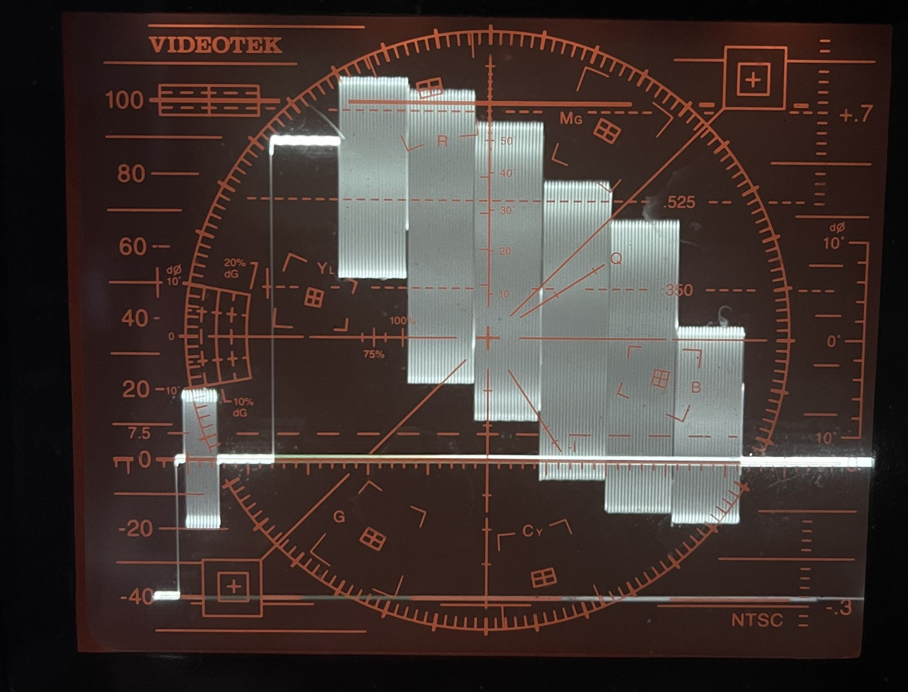
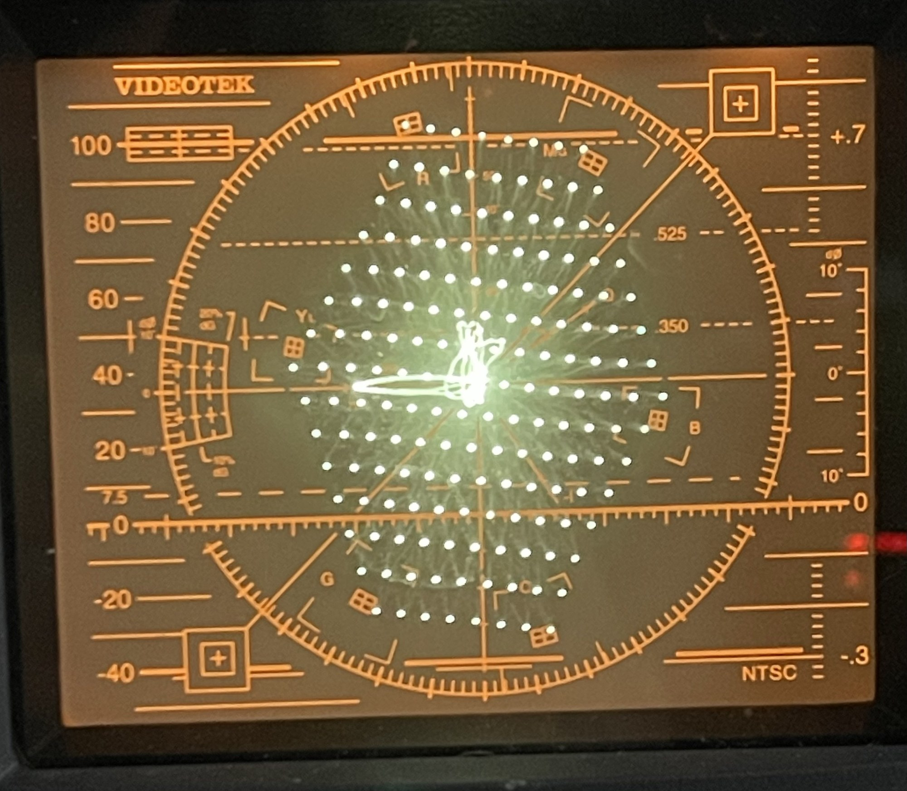
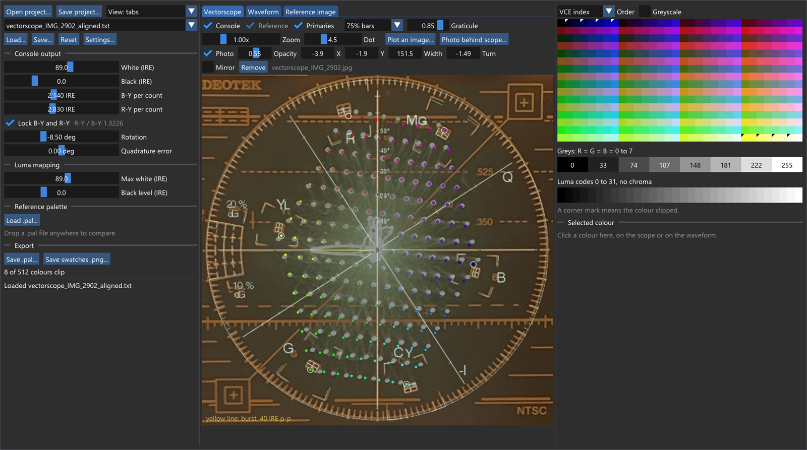

# HuC6260 composite colour path: findings

## 1. Scope

This document records what was established about the composite (NTSC) colour
output of the Hudson HuC6260 Video Colour Encoder (VCE) used in the PC Engine
and TurboGrafx-16, the evidence for each item, the colour model derived from
it, and the items that remain open.

Each finding carries one of these status labels:

| Label | Meaning |
|---|---|
| Verified | Checked exhaustively against primary data (ROM dump). |
| Measured | Read from an instrument capture; uncertainty stated. |
| Observed | Read from the die photograph or schematic; not traced at gate level. |
| Patent | Stated in a patent; not confirmed on hardware unless noted. |
| Inferred | Follows from other findings; not directly tested. |

## 2. Sources

| ID | Source | Content |
|---|---|---|
| P1 | US 5,059,955, Hudson Soft, priority 1987, granted 1991 | VCE: colour table RAM, CPU bus, RGB and composite outputs |
| P2 | US 5,389,949, Seiko Epson, priority 1987, granted 1995 | VCE: composite encoder circuits to gate and transistor level |
| P3 | US 4,727,361, Toshiba, priority 1986, granted 1988 | Digital NTSC encoder cited by P1 as prior art. Not the VCE. |
| P4 | US 4,924,744, Hudson Soft, priority 1987, granted 1990 | PSG sound generator |
| P5 | US 5,319,786, Hudson Soft, priority 1987, granted 1994 | VDC (HuC6270) |
| ROM | Dump of the HuC6260 matrix ROM, 512 entries of Y, R-Y, B-Y. Dumps from multiple chips, from the first 1987 system to the last 1994 system, are identical (author). | Primary data |
| DIE | Die photograph of a HuC6260 (marking reads HuC6260), siliconpr0n.org/map/hudson/huc6260/ | DAC and pad structure |
| SCH | TurboGrafx-16 service manual, HuC6260 circuit sheet | External mixing network |
| MAN | Hudson HuC6260 manual, scan ending at page H6-5 | Dot clock settings. The page covering the Y, R-Y, B-Y and BURST outputs is missing from the scan. |
| VS | Vectorscope capture, Videotek NTSC instrument, test ROM showing all 512 colours separated by black. `captures/vectorscope_IMG_2902.jpg` | Chroma lattice |
| WFM | Waveform-monitor capture, same instrument, colour-bar ROM, sync set to -40 IRE. `captures/waveform_IMG_2232.jpg` | Luma and chroma levels |

About ten consoles across the model range were checked on the vectorscope by
the author. All showed the same pattern, including the rotation in section 10.
Capture VS is representative of that set. All numeric measurements in this
document are from the one console in captures VS and WFM.

## 3. Summary of results

| Quantity | Value | Status | Section |
|---|---|---|---|
| Luma code | Y = floor(1.33R + 2.61G + 0.49B + 0.5), 0 to 31 | Verified, 512/512 | 5 |
| R-Y code | 2(R - G), -14 to +14 | Verified, 512/512 | 5 |
| B-Y code | 2B - R - G, -14 to +14 | Verified, 512/512 | 5 |
| Distinct chroma points | 169 | Verified; 169 dots on VS | 5, 10 |
| ROM contents across production | Identical, 1987 to 1994 systems | Verified by dump comparison (author) | 5 |
| Chroma DAC levels | 31; codes 0F and 10 share one node | Observed (DIE), consistent with VS | 6 |
| On-chip chroma filter | None | Observed (DIE) | 6 |
| Mixing resistors | Y 4.7k, R-Y 6.2k, B-Y 8.2k | Observed (SCH) | 8 |
| R-Y / B-Y gain | 1.3226 (8.2k / 6.2k); 1.29 to 1.32 measured | Observed, Measured | 8, 10 |
| White level | 89 IRE with sync at 40 IRE | Measured | 9 |
| Black level | 0 IRE (blanking level; no 7.5 IRE pedestal) | Measured | 9 |
| Burst | 37 to 40 IRE p-p with sync at 40 IRE | Measured | 9 |
| Chroma per B-Y count | 2.14 IRE with burst taken as 40 IRE p-p (2.11 to 2.18) | Measured | 10 |
| Rotation of chroma against burst | -8.5 deg (-8.3 to -8.7; earlier estimate +/-1.5) | Measured | 10 |
| Quadrature error | 0 adopted; +0.4 to +1.2 deg read from VS, not trusted | Measured | 10 |
| Saturation of full-level primaries | 75% to 81% of full saturation at 89 IRE white | Measured, model | 9, 13 |
| Carrier shape (square or three-level) | Not determined | Open | 7, 15 |

## 4. Patents

### 4.1 Identification

P1 and P2 describe the same chip. Status: Patent.

- Both were first filed in the US on 30 August 1988 and claim Japanese
  priority of 2 September 1987, with application numbers within three of
  each other. The 1995 grant date of P2 follows three abandoned applications.
- Kimio Yamamura is sole inventor on P1, P4 and P5 and a co-inventor on P2.
- FIG. 1 and FIG. 2 of P2 are the block diagrams of P1 redrawn, with the same
  512 x 9 colour table RAM and 512 x 15 matrix ROM.
- P1 covers the palette and bus side and leaves the composite encoder as
  blocks. P2 details those blocks.

### 4.2 Signal path as described

1. Pixel input. The VDC supplies 9 bits per dot: VD8 selects sprite or
   background, VD7-4 a palette block, VD3-0 a colour within it.
2. Colour table RAM. 512 entries of 9 bits (G, R, B, 3 bits each): 256
   background and 256 sprite entries in 16 blocks of 16. CPU access is through
   a control register (dot clock divider), an auto-incrementing address and a
   data register. The address decode corresponds to offsets 0, 2-3 and 4-5.
3. Palette-write hold (P1 claims 2 and 3). During CPU access the RAM is
   addressed by the CPU. The output latch clock is gated off while CS is low
   and for a fixed delay afterwards, so the last pixel is held. P1 FIG. 8B
   draws the hold as 3 dot clocks after CS rises.
4. RGB output. Three 3-bit DACs and composite sync.
5. Matrix ROM. The latched RGB value addresses a ROM returning 5-bit Y, R-Y
   and B-Y. One further flip-flop follows the ROM, so composite is one dot
   clock later than RGB.
6. Modulation (P2). Colour-difference values are a sign bit plus one's
   complement. Each bit is XNORed with a subcarrier-rate clock, one clock per
   axis, 90 degrees apart. The 90 degree offset uses both edges of the master
   clock: the R-Y carrier switches 1.5 master-clock periods after the B-Y
   carrier. The figures of P2 disagree with each other about which carrier
   leads.
7. Second embodiment (P2). A "modulation zero" pulse is added at each carrier
   transition. As drawn in FIG. 2(c) the carrier is +,+,0,-,-,0 per subcarrier
   cycle at the 21.47727 MHz master clock. The tick widths are read from the
   drawing; the text does not state them.
8. DACs (P2). Each is a resistor string with transmission gates. A centre tap
   is selected during blanking and during the zero slots. P2 states that with
   no colour-difference component the output stays at mid-level and no carrier
   leak arises.
9. Burst (P2). A three-state driver switches between a high reference, a low
   reference and their midpoint for 8 to 9 cycles on the back porch, in
   opposite phase to the +(B-Y) carrier. It is a two-level square wave.
10. Mixing (P2 FIG. 14). Y with sync, the two modulated signals and burst are
    summed through adjustable resistors into an NPN emitter follower. Claim 7
    implies the transistor is outside the MOS chip. No filter is drawn.

Items 3 (FIG. 8B), 5 (extra flip-flop), 6 (1.5 period offset) and 9 are from a
second reading of the patent scans and were not individually rechecked.

### 4.3 Disagreements between P1 and P2

| Subject | P1 | P2 | Hardware |
|---|---|---|---|
| Modulator position | DAC first, then analogue modulators | Digital modulation, then DAC | Carriers are present on the R-Y and B-Y pins (oscilloscope, author). Consistent with P2. |
| ROM sample table | FIG. 7: B-Y = +8, +10, +12, +14 for pure blue 4-7, R-Y zero | Equations; table called "exemplary" | Chroma follows P1 FIG. 7. Luma follows the P2 equation. Section 5. |
| Dot clocks | /4 and /3 only, described as "composite" and "RGB" modes | - | The chip also has /2 (10.74 MHz). |

### 4.4 Not present in either patent

The black-and-white (burst off) control bit, the 262/263 line option, the /2
dot clock, and any component values. The only voltages given are an example
table of +/-1.5 V. P1 describes an EX 8/16 pin and nine data lines; SCH straps
that pin to +5 V (8-bit mode).

### 4.5 Other patents in the set

- P3: teletext-style encoder with 15 fixed colours decoded by gates, sampled
  at 4 x subcarrier, digitally filtered, one 8-bit DAC. It applies the NTSC
  weights 1/1.14 and 1/2.03 in logic.
- P4: six channels of 32-step 5-bit wave memory, noise on channels 5 and 6,
  channel 2 as LFO for channel 1, direct D/A mode, registers R0 to R9.
- P5: register-level description of the VDC. The claims cover only the raster
  compare interrupt.

## 5. Matrix ROM

Status: Verified against the ROM dump, 512 of 512 entries for each equation.

| Output | Equation | Result |
|---|---|---|
| Y | floor(1.33R + 2.61G + 0.49B + 0.5) | 512/512 match. All 32 codes occur. |
| R-Y | 2(R - G) | 512/512 match |
| B-Y | 2B - R - G | 512/512 match |
| R-Y, P2 equation | - | 328 entries differ |
| B-Y, P2 equation | - | 364 entries differ |

R, G and B are the 3-bit palette values (0 to 7).

- Encoding: sign bit plus one's complement. Codes 16-31 are positive, 15-0
  negative.
- Zero is stored as 0F in the R-Y column and as 10 in the B-Y column,
  throughout the dump and in P1 FIG. 7.
- The chroma codes span 1 to 30 (+/-14). The outermost DAC step on each side
  is not used.
- Chroma depends only on R - G and B - G. The 512 colours occupy 169 distinct
  (B-Y, R-Y) pairs, a hexagonal lattice 15 rows high.
- P1 FIG. 7 matches the dump. The chroma equations of P2 do not.
- ROM dumps from multiple chips, from the first 1987 system to the last 1994
  system, were compared by the author. All are identical. The table did not
  change during production and is not set per unit.

Coefficients compared with NTSC on the same scale:

| Axis | ROM (R, G, B) | NTSC (R, G, B) |
|---|---|---|
| R-Y | 2, -2, 0 | 2, -1.69, -0.31 |
| B-Y | -1, -1, 2 | -0.67, -1.33, 2 |

Blue does not contribute to the R-Y output. Pure blue and pure yellow
therefore lie exactly on the B-Y carrier axis.

Grey detection. Status: Verified (arithmetic), Inferred (absence of a
detector).

- 22 ROM entries have R-Y code + B-Y code = 1F. 8 are greys; 14 are coloured
  (for example R=3, G=1, B=0: B-Y = 11, R-Y = 20). A sum or XOR test does not
  isolate grey.
- The test "R-Y = 0F and B-Y = 10" isolates exactly the 8 greys. It needs two
  5-bit comparisons and would cost the same with identical zero codes.
- Neither patent describes a grey detector. A zero code places the DAC at its
  centre node (section 6), so none is required to suppress the carrier.
- Conjecture, untested: the two zero codes are a by-product of how each column
  was computed. In one's complement, x + NOT(x) yields negative zero (0F).

## 6. D/A converters

Status: Observed on DIE. Not traced at gate level.

Chroma DACs (R-Y and B-Y):

- 33 switch columns each.
- The three centre columns land on one metal plate routed towards the centre
  pin. Codes 0F and 10 and the forced-centre switch are the same node.
- 15 resistor segments on each side of the centre: 31 output levels.
- The R-Y and B-Y DACs have identical layouts, including metal trim. Their
  different contribution to the output comes only from the external resistors.
- P2 FIG. 12 draws the same shared centre node.

Consistency with VS: if codes 0F and 10 were half a step apart, the spacing of
the central lattice rows would be 1.5 steps. The measured spacings are 1.03
and 1.03 steps. A half-step model fits the dots 2.4 times worse.

Luma DAC:

- Continuous resistor string with a separate tap for every code.
- 36 switch columns. Three extra columns at the left route to taps in the
  lower resistor rows, consistent with sync being inserted in the Y DAC as
  both patents describe.

Matrix ROM array:

- The die has two memory arrays. The smaller one, left of centre, has 15
  output cells along one edge and address decoders on two sides. Its cell
  pitch is 18.5 x 10.4 px in the photograph over 1216 x 1375 px: about 66
  columns by 132 rows, of which about 12 rows are straps. 64 x 120 = 7680
  cells = 512 x 15 bits. It is identified as the matrix ROM on that basis.
- The larger array occupies about 7 times the area for 0.6 times the bits
  (512 x 9), consistent with static RAM cells: the colour table RAM.
- No programming structures are visible at the ROM block: no write drivers,
  high-voltage devices, charge pump, fuse windows or extra pads. The data path
  is read-only at block level.
- The only probe pads on the die that are not bond pads belong to a
  self-contained, guard-ringed test structure (14 pads, four test devices, a
  tapped resistor). Its wiring does not leave the ring. It is a process
  monitor.
- The photograph does not resolve individual ROM bits, so the programming
  layer (diffusion, contact or implant mask) was not determined and the
  contents could not be read from the die.
- The table is identical on every chip dumped, 1987 to 1994 (section 5). With
  no programming structures on the die, it is a mask ROM. Also consistent: the
  contents are three closed-form integer rules; P1 FIG. 7, filed in 1988,
  prints the same values including the two zero codes; about ten consoles show
  the same lattice.

Other observations:

- Metal trim: segments in the lower resistor rows are shorted by metal, about
  7 of 20 on the chroma DACs and 8 of 28 on the luma DAC. These are mask
  options, the same on every chip, not per-unit adjustments. No laser-cut
  links were seen in the DAC area; the rest of the die was not searched for
  them.
- Between the resistor strings and the pads there are only switch columns,
  metal routing and pad protection cells. There is no inductor, capacitor
  plate or amplifier. The chip has no reconstruction or notch filter on these
  outputs.
- Not determined from the photograph: whether the centre switch is pulsed
  every half cycle (which modulator embodiment was built), whether any grey
  detector exists, and how the bias resistor rows are wired.

## 7. Modulator and carrier

### 7.1 Carrier shape

Status: Patent for the two candidate shapes; which one was built is open.

| Harmonic | Frequency | Square (first embodiment) | +,+,0,-,-,0 (second embodiment) |
|---|---|---|---|
| Fundamental | 3.58 MHz | 4/pi = 1.273 x step level | 2 sqrt(3)/pi = 1.103 x step level |
| 3rd | 10.74 MHz | 33% of fundamental | 0 |
| 5th | 17.90 MHz | 20% | 20% |
| 7th | 25.06 MHz | 14% | 14% |

- The three-level sequence equals a sine sampled six times per cycle and held.
- The burst is drawn as a two-level square wave in both embodiments. Chroma
  and burst therefore have different fundamental factors in the second
  embodiment.
- Oscilloscope observation (author): the modulated outputs appear as a smooth
  sine. Probe point and bandwidth were not recorded. This does not separate
  the embodiments. A spectrum measurement would: a component at 10.74 MHz
  indicates the square carrier.
- WFM envelope fit (section 9) does not separate them either: the monitor's
  bandwidth removes the harmonics.

### 7.2 Pixel rate against carrier

Status: Inferred from the clock ratios (master clock 21.47727 MHz = 6 x
subcarrier) and from the absence of an on-chip filter.

| Dot clock | Master clocks per pixel | Subcarrier phase per pixel |
|---|---|---|
| 5.37 MHz | 4 | 240 deg |
| 7.16 MHz | 3 | 180 deg |
| 10.74 MHz | 2 | 120 deg |

- Pixel-rate colour-difference data is modulated directly onto the carrier
  with no band limiting. A single pixel never spans a full carrier cycle.
- At 5.37 MHz the chroma sidebands extend from about 0.9 to 6.3 MHz. At 7.16
  MHz the lower sideband reaches DC. At 10.74 MHz it folds back.
- One line is 1365 master clocks = 227.5 subcarrier cycles. The carrier
  inverts against the pixel grid on every line.
- 262 lines contain a whole number of carrier cycles (59605): patterns are
  static from frame to frame. 263 lines leave half a cycle (59832.5): every
  pattern inverts each frame.
- The chip can shift carrier phase only in steps of half a master clock
  (30 deg). The rotation in section 10 is therefore analogue in origin.

## 8. External mixing network

Status: Observed on SCH.

| Signal | Path |
|---|---|
| Y | 4.7k to common node |
| R-Y | 6.2k to common node |
| B-Y | 8.2k to common node |
| Common node | 1k to transistor base |
| Burst | 27k directly to transistor base |
| DAC "+" reference pins | +5A |
| DAC "-" and centre pins | 1 uF to ground only |

- R-Y / B-Y mixing ratio from the resistors: 8.2 / 6.2 = 1.3226. VS gives 1.29
  to 1.32 independently (section 10).
- The ROM scales both colour-difference signals to the same +/-14 range. The
  NTSC weights (R-Y / 1.14, B-Y / 2.03) would require a ratio of about 1.40.
  The built ratio is 1.32.
- DAC levels are set inside the chip. No reference voltage was measured.
- Candidate cause of the rotation in section 10, untested: capacitance at the
  common node delays picture chroma, while burst bypasses that node. A delay
  of 8.5 deg at 3.58 MHz corresponds to a time constant of 6.6 ns, of the
  order of 10 pF at that node. Test: a probe on the common node should
  increase the rotation; a probe on the transistor base should not.

## 9. Waveform-monitor measurement

Status: Measured from capture WFM. Sync set to -40 IRE.



| Level | Reading |
|---|---|
| Black | 0 IRE, equal to blanking. There is no 7.5 IRE pedestal. |
| White | 89 IRE |
| Burst | 37 to 40 IRE p-p, depending on the beam width subtracted |
| Bar luma | All six bars within 1.7 IRE of Y code / 31 x 89 |
| Bar chroma | 70% to 83% of the chroma a fully saturated colour needs at 89 IRE white |

Luma is linear in the ROM code. No primary reaches full saturation.

Chroma envelopes of the six bars compared with three carrier models, burst
taken as 37 IRE p-p:

| Model | Model / measured, mean | Range |
|---|---|---|
| Fundamental only (plain vector sum) | 1.010 | 0.974 to 1.066 |
| Three-level carrier, peak | 1.088 | 0.945 to 1.176 |
| Square carrier, peak | 0.942 | 0.818 to 1.018 |

The fundamental-only model fits within 7%. The instrument's bandwidth removes
the carrier harmonics, so this result does not identify the carrier shape.

## 10. Vectorscope measurement

Status: Measured from capture VS.



### 10.1 Lattice

- 169 positions are expected. 164 dots were located; the remainder lie under
  the centre glow and the burst trace.
- After allowing for smooth lens and CRT distortion (cubic), the dots fit an
  exact lattice with 4.2 px rms error on a 3021 px wide photograph.
- The P1 FIG. 7 rule fits with 4.2 px rms. The P2 chroma equations rounded to
  5-bit codes fit with 20.3 px rms.
- Red-to-blue angle: 111.3 to 111.8 deg measured; about 111 deg from the ROM
  rule with the measured gain ratio; about 116 deg from the P2 equations.
- The graticule circle is round to 0.5% in the photograph.

### 10.2 Lattice parameters

Two independent rulers were used: the burst trace, and the graticule boxes
(section 11).

| Quantity | Burst as ruler | Graticule boxes as ruler |
|---|---|---|
| Chroma per B-Y count | 2.14 IRE (2.11 to 2.18) | 2.150 IRE |
| R-Y / B-Y gain | 1.29 to 1.32 | 1.311 |
| B-Y axis against burst | -8.5 deg | -8.3 deg (axis at -7.49 deg on the graticule, burst at 180.8 deg) |
| Quadrature error | not resolved | +1.05 deg (inner dots +0.39, outer dots +1.15) |
| Fit residual | - | 0.67 IRE rms, 2.22 IRE maximum |
| Lattice centre offset from graticule centre | - | (+0.30, +0.47) IRE |

The graticule fit is a straight-line fit of all 164 dots with no distortion
allowance. The quadrature figure varies with the region fitted and is within
the geometric error of the photograph; zero was retained.

### 10.3 Hue of the primaries

From the model of section 12 with the default parameters:

| Colour | Phase | NTSC | Difference |
|---|---|---|---|
| Red | 102.2 deg | 103.5 deg | -1.2 deg |
| Magenta | 60.8 deg | 60.7 deg | +0.1 deg |
| Blue | 351.5 deg | 347.1 deg | +4.4 deg |
| Cyan | 282.2 deg | 283.5 deg | -1.2 deg |
| Green | 240.8 deg | 240.7 deg | +0.1 deg |
| Yellow | 171.5 deg | 167.1 deg | +4.4 deg |

Without the rotation, blue and yellow lie on the B-Y axis (0 and 180 deg).
With it, four of the six primaries are within 1.2 deg of their NTSC phases.

## 11. Vectorscope graticule calibration

Status: Measured.

The graticule used by the tool is `assets/vector_scope_overlay__v4.png`, a
tracing of the instrument graticule.

| Quantity | Overlay image | Instrument (VS, WFM) |
|---|---|---|
| Box centre phase error against standard colour-bar phases | 0.05 deg mean, 0.2 deg maximum | - |
| Scale of the six box centres | 418.5 px per unit of U/V, 0.2% spread | - |
| Circle radius / red box radius | 1.198 | 1.196 |
| Burst mark for 75% bars | not drawn | 0.3814 of circle radius |
| Burst mark for 100% bars | not drawn | 0.2858 of circle radius |
| +/-10% marks about the 75% burst mark | not drawn | 0.4192 and 0.3431 of circle radius |

- Box centres, with burst at 40 IRE p-p: red and cyan 43.9 IRE, green and
  magenta 41.0 IRE, blue and yellow 31.0 IRE. The red box is at 2.19 x the
  burst peak.
- This places the circle at 52.5 IRE. Burst at 20 IRE peak then lies at 0.3808
  of the circle radius for 75% bars and 0.2856 for 100% bars. The instrument's
  own burst marks are at 0.3814 and 0.2858.
- The two rulers of section 10.2 agree on this scale: 2.14 IRE per count from
  burst, 2.15 from the boxes.
- The earlier Python tool (PCE_pal_maker) scales Cb and Cr by 0.78 and 1.1.
  The exact factors for this graticule are 0.763 and 1.076. Its plot is 2.2%
  larger.

## 12. Colour model

For palette values R, G, B (0 to 7):

```
Y   = floor(1.33 R + 2.61 G + 0.49 B + 0.5)        0..31
BY  = 2 B - R - G                                  -14..+14
RY  = 2 (R - G)                                    -14..+14

luma  = black + Y / 31 * (white - black)           IRE
U     = k * BY * cos(rot) + k * g * RY * cos(rot + 90 + q)
V     = k * BY * sin(rot) + k * g * RY * sin(rot + 90 + q)
```

U and V are in IRE on a vectorscope with burst at 40 IRE p-p and at 180 deg.

| Parameter | Symbol | Default | Source |
|---|---|---|---|
| White level | white | 89 IRE | WFM |
| Black level | black | 0 IRE | WFM |
| Chroma per B-Y count | k | 2.14 IRE | VS |
| R-Y / B-Y gain | g | 8.2 / 6.2 | SCH, VS |
| Rotation | rot | -8.5 deg | VS |
| Quadrature error | q | 0 deg | VS (not resolved) |
| Burst | - | 37 IRE p-p | WFM |

Television decode (standard NTSC):

```
gain  = 1 / (white - black)        contrast set so white is full scale
B'-Y' = U * gain * saturation / 0.492
R'-Y' = V * gain * saturation / 0.877
G'-Y' = -(0.299 (R'-Y') + 0.114 (B'-Y')) / 0.587
```

- Chroma is referred to burst (automatic chroma control). Without it, chroma
  is scaled by burst / 40.
- An optional picture-tube stage applies gamma, converts from SMPTE C, NTSC
  1953 or Rec. 709 primaries and a D65, Illuminant C or 9300 K white point to
  sRGB.
- With the defaults, 8 of 512 entries clip: (R,G,B) = (0,0,1), (0,0,3),
  (0,0,5), (0,0,7), (7,7,0), (7,7,2), (7,7,4), (7,7,6).
- The tool's palette export with default parameters is byte-identical to
  `research/vce_composite.pal`, produced by `research/make_vce_palette.py`.

## 13. Model output for colour bars

| Bar | Y code | B-Y | R-Y | Luma IRE | Chroma IRE | Phase | Chroma / 75% box | Saturation | sRGB |
|---|---|---|---|---|---|---|---|---|---|
| White | 31 | 0 | 0 | 89.0 | 0 | - | - | - | 255, 255, 255 |
| Yellow | 28 | -14 | 0 | 80.4 | 30.0 | 171.5 | 0.966 | 75% | 245, 255, 58 |
| Cyan | 22 | +7 | -14 | 63.2 | 42.4 | 282.2 | 0.966 | 75% | 46, 240, 233 |
| Green | 18 | -7 | -14 | 51.7 | 42.4 | 240.8 | 1.034 | 81% | 27, 233, 28 |
| Magenta | 13 | +7 | +14 | 37.3 | 42.4 | 60.8 | 1.034 | 81% | 228, 22, 227 |
| Red | 9 | -7 | +14 | 25.8 | 42.4 | 102.2 | 0.966 | 75% | 209, 15, 22 |
| Blue | 3 | +14 | 0 | 8.6 | 30.0 | 351.5 | 0.966 | 75% | 10, 0, 197 |
| Black | 0 | 0 | 0 | 0 | 0 | - | - | - | 0, 0, 0 |

"Saturation" is chroma relative to the chroma of a fully saturated colour with
white at 89 IRE. The full-level primaries lie on the 75% colour-bar boxes
within 3.4% in amplitude.

Model against capture VS, both on the graticule scale: median distance between
model and photographed dots 0.80 IRE, rms 1.23 IRE, maximum 3.01 IRE. One
lattice step is 4.28 IRE.



## 14. Comparison with existing palettes

Status: Measured (palette files).

The model was fitted to three palette files from the earlier Python tool:

| File | Chroma per count | R-Y / B-Y gain | Rotation | Quadrature | Residual |
|---|---|---|---|---|---|
| gen_pal.pal | 2.117 IRE | 1.314 | -9.49 deg | +0.80 deg | within 1 level |
| pce.pal | 2.048 IRE | 1.322 | -9.97 deg | -0.29 deg | within 7 levels; contrast 1.142 |
| palette.pal | 2.207 IRE | 1.288 | -9.86 deg | +1.34 deg | within 1 level |

- Model default against gen_pal.pal: mean difference 0.85 levels, maximum 4
  (entry $03E).
- Against the palette previously loaded in Mesen 2 (the author's, with a
  deliberate saturation increase): mean difference 5 levels, maximum 16. Its
  blue-axis chroma is within about 1% of the model, its red axis about 8%
  weaker, and its axes are about 96 deg apart against 90 to 91 deg measured.

## 15. Open items

| Item | What would settle it |
|---|---|
| Carrier shape: square or +,+,0,-,-,0 | Spectrum of an R-Y or B-Y pin: component at 10.74 MHz present or absent. Alternatively gate-level tracing of DIE. |
| Existence of a grey detector | Gate-level tracing of DIE |
| Matrix ROM programming layer (diffusion, contact or implant) | A higher-magnification or delayered image of the ROM array. Does not affect the model. |
| Wiring of the DAC bias resistor rows; reference voltages | Tracing of DIE; DC readings on the Y, R-Y, B-Y and BRT reference pins |
| Cause of the -8.5 deg rotation | Probe loading test at the common node and at the transistor base (section 8) |
| Quadrature error | A capture with less geometric error than a photograph |
| Alignment of pixel edges to the carrier | Oscilloscope capture of a pixel edge against burst |
| Board revisions | SCH is the TurboGrafx-16 sheet. Other revisions were not compared. |
| Missing manual page | A complete scan of MAN (page H6-6) |

## 16. Limits of the measurements

- VS and WFM are photographs of CRT instruments. Geometric error of the
  photograph and trace width limit phase readings to about 1 degree and
  amplitude readings to about 2%.
- All numeric values are from one console. The pattern, including rotation,
  was observed on about ten consoles.
- Die observations are from optical inspection of the metal layer and were not
  confirmed by tracing.

## 17. Repository contents

| Path | Content |
|---|---|
| `src/vce_model.*` | The model of section 12 |
| `src/app.cpp`, `src/main.cpp` | Vectorscope, waveform view, palette grid |
| `assets/vector_scope_overlay__v4.png` | Graticule (section 11) |
| `captures/` | Captures VS and WFM, and the alignment of VS to the graticule |
| `research/make_vce_palette.py` | Palette generator; writes `vce_composite.pal` |
| `research/artifact_sim.py`, `research/composite_preview.py` | Composite signal simulations; not covered in this document |
| `research/preview/` | Output of those simulations |
| `docs/img/` | Screenshots |
