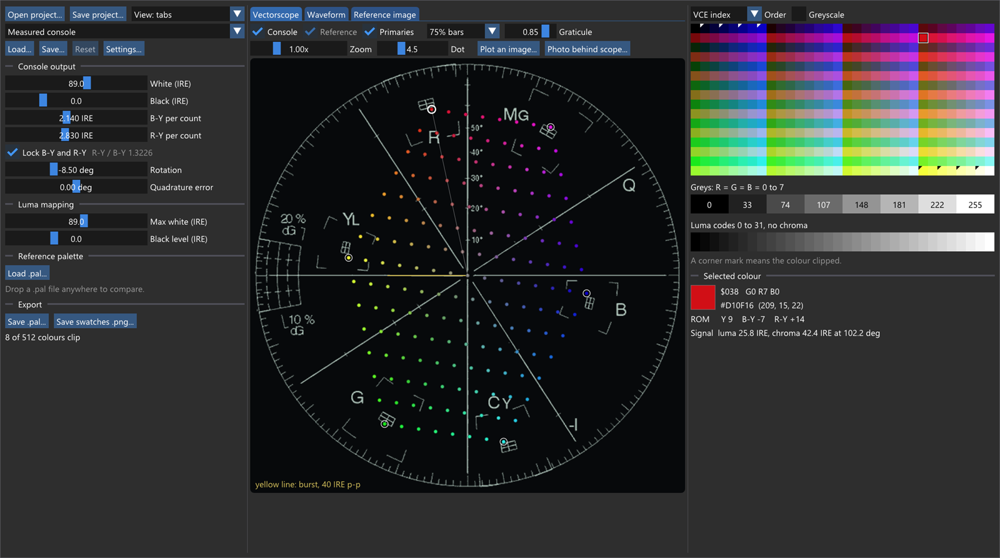
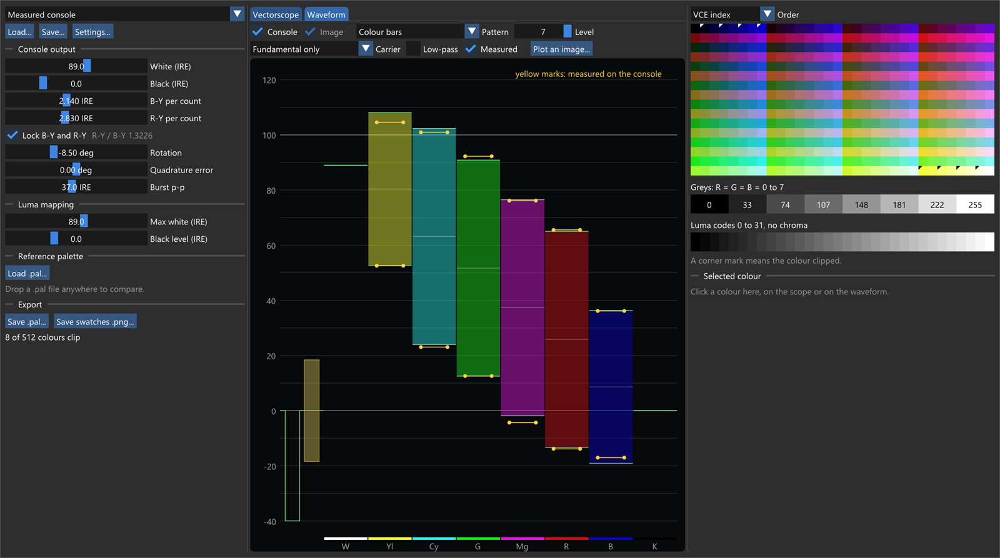
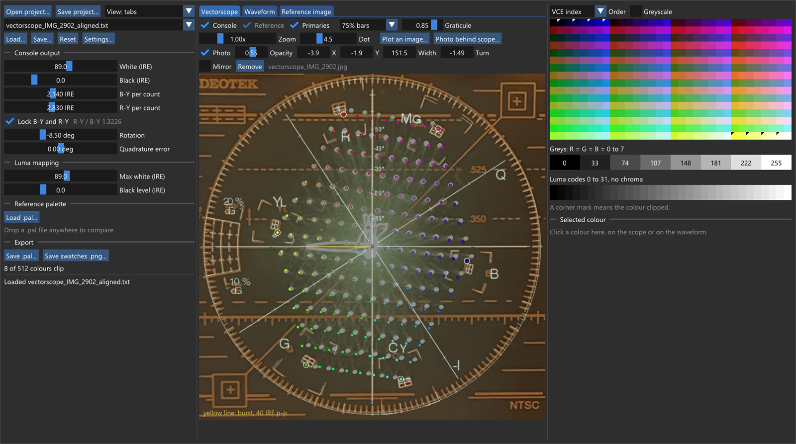
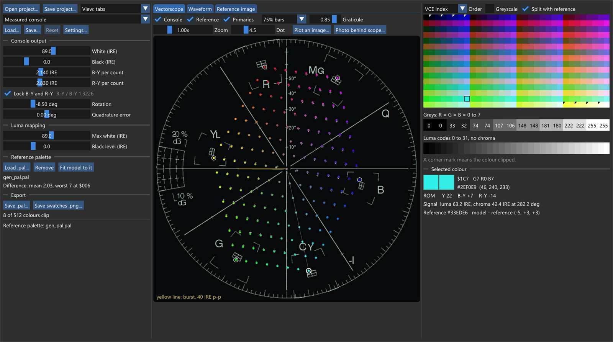
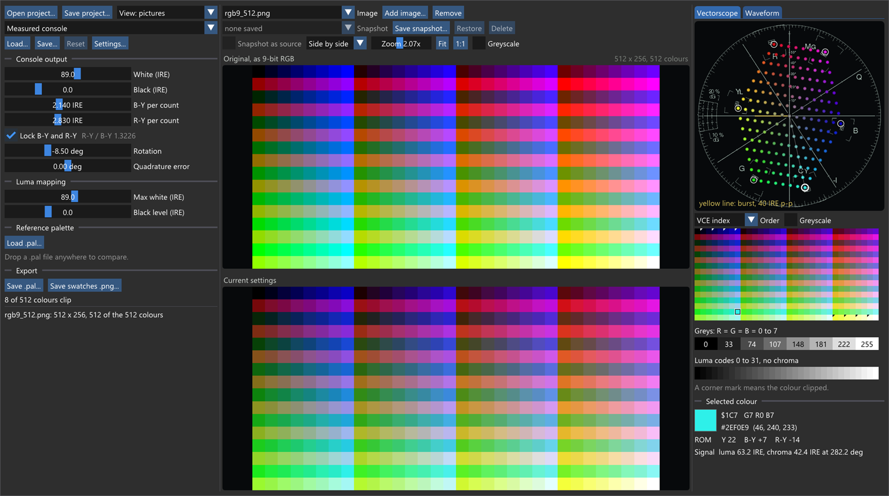

# PCE Vectorscope and Palette Generator

A model of the PC Engine / TurboGrafx-16 composite colour path (HuC6260 matrix
ROM, D/A converters, mixing resistors, NTSC decode) with a vectorscope, a
waveform view, a before and after view of a picture, and a 512-colour palette
export for Mesen 2.

It runs as a Windows program, and in a browser at
<https://turboxray.github.io/pce_vectorscope/>.

The measurements behind the model, and what is still open, are in
[FINDINGS.md](FINDINGS.md).

## Screenshots

Vectorscope: the 512 colours (169 distinct points) on an NTSC graticule.

Waveform view: colour bars, each as its luma level with the chroma envelope
around it.

The model over a capture from a real vectorscope.

A reference palette (white crosses) compared with the model.

A reference image in the "pictures" view: the picture in plain 9-bit RGB above,
and as the current settings make it below.

## Download

The release page has a Windows x64 build. It is a single statically linked
exe with nothing to install. The archive also contains `vce_composite.pal`,
the palette the model produces with its default settings, ready to load with
the palette loader in Mesen 2's PC Engine settings.

## Build

Needs [w64devkit](https://github.com/skeeto/w64devkit) (gcc, cmake, make) at
`C:\w64devkit`, or set `W64DEVKIT` to its folder.

    build.bat

The result is `build\pce_vectorscope.exe`.

### Browser version

The same program builds as a web page with the
[Emscripten SDK](https://emscripten.org/docs/getting_started/downloads.html)
(at `C:\emsdk`, or set `EMSDK` to its folder):

    build_web.bat

The result is `build_web\site` (`index.html`, `index.js`, `index.wasm`). Serve
that folder over HTTP to try it, for example
`python -m http.server -d build_web\site 8000`.
`.github/workflows/pages.yml` does the same build on every push to `main` and
publishes it with GitHub Pages at
<https://turboxray.github.io/pce_vectorscope/>; the repository's Pages source
has to be set to "GitHub Actions" for that.

In a browser, a file is picked or dropped onto the page instead of being read
from a path, and a saved file arrives as a download. There is no command line;
`?view=pictures` and the other view options can go in the address instead.

## Use

- Left: the model. The drop-down at the top shows what the settings were
  loaded from. "Reset" puts every setting back to its default, after asking.
  Every slider has a tooltip saying what it is and what was
  measured. Ctrl+click a slider to type a value. The B-Y and R-Y steps move
  as one while "Lock B-Y and R-Y" is ticked, and separately when it is not.
- "Open project..." and "Save project..." keep everything in the window in one
  `.pcevs` file: the settings, the snapshots, the pictures and the reference
  palette. The files go into the project itself, so it opens anywhere; one
  that is still where it was is read from there instead.
- "View: tabs" has the vectorscope, the waveform and the reference image take
  turns in the middle. "View: pictures" gives the middle to the two pictures
  of the reference image and reduces the vectorscope, waveform and 512
  colours beside them.
- Middle: vectorscope (burst = 40 IRE p-p) and waveform view (sync = 40 IRE),
  showing the signal the console puts out.
- "Reference image" shows a picture before and after. "Add image..." takes a
  picture in plain 9-bit RGB: eight evenly spaced levels in each channel,
  whatever the size of the step (32, 34, 36 and 255 / 7 all count). It is
  prepared first: every pixel is taken to its 9-bit colour, and that is the
  "original" shown. A picture with values on no such ramp (a 27, say) brings
  up a warning; used anyway, each colour is taken as the nearest of the 512.
  Several pictures can be loaded and picked from the list.
- "Save snapshot..." keeps the current settings under a name. The snapshot in
  the list is the assigned one. With "Snapshot as source" ticked the source
  picture is the image through that snapshot instead of the original, so two
  sets of settings can be compared. "Restore" puts the settings back to the
  snapshot's, after asking.
- The two pictures show side by side (or one above the other), or as one
  larger picture that flips between them ("Flip", the space bar or a right
  click), or as one larger picture split by a bar ("Sweep"): the source to the
  left of the bar, the current settings to the right. Drag the bar, or hold
  the right button on the picture and it follows the pointer; "Auto", or the
  space bar, makes it sweep from side to side by itself.
- The mouse wheel zooms, about the pointer; zoomed in, drag with the left
  button to move around. Both pictures always show the same part. The pointer
  shows the colour under it three ways, and a click selects it.
- "Greyscale" beside the zoom shows the pictures as luma alone: the original
  as the luma of its RGB colours, a snapshot and the current settings as the
  grey of each colour's luma code.
- "Luma mapping" sets which signal levels come out as full white and as
  black.
- "Settings..." can show the post adjustment (contrast, brightness, colour,
  tint) and a "Post" box on both views, which plots the final colours of the
  palette; on the waveform with black at 0 IRE and full white at 100. Post
  adjustment changes the decoded colours, not the signal. It is hidden by
  default and not recommended: such controls belong in the emulator or on
  the display, not baked into the palette file.
- Right: the 512 colours. Click one to select it everywhere. A triangle in
  the corner of a colour means it clipped: its R, G or B fell outside 0 to
  255 and was cut off. "Greyscale" shows each colour as its luma alone. Under
  the grid, the eight greys (R = G = B) and all 32 luma codes with no chroma,
  as final colours.
- Drop a `.pal` to compare against it, a saved parameter `.txt` to load it, a
  `.pcevs` project to open it, or an image: the program asks whether to plot
  its colours, add it as a reference image, or put it behind the scope as a
  photo of a real one.
- A plotted image shows on both views, beside the generated output or on its
  own ("Image" box). On the vectorscope it is its colours. On the waveform it
  is its pure greys ("Grey steps"), its luma levels ("All 32 luma codes") or
  an R, G, B parade, with full white at 100 IRE.
- With a photo shown: Shift+drag moves it, Shift+wheel resizes it, Ctrl+wheel
  turns it. The alignment is saved with the parameters.
- `captures\vectorscope_IMG_2902_aligned.txt` loads the capture of a real
  console already lined up with the graticule.
- "Fit model to it" sets the chroma numbers so the model reproduces the
  reference palette.

### Vectorscope conventions

- The graticule is `assets/vector_scope_overlay__v4.png`, compiled into the
  exe. Its boxes are the NTSC 75% bar targets: red at 43.9 IRE against 40 IRE
  p-p burst, the circle at 52.5 IRE.
- The console's dots are placed by their signal level against burst, as on
  the instrument.
- RGB data (the reference palette, a plotted image, "Post") is placed as
  that picture encoded to NTSC, so 75% RGB bars land in the boxes.
- "75% bars / 100% bars" is the instrument's gain switch.
- To use another graticule image, replace the PNG and set the `GRAT_`
  constants at the top of `src/app.cpp` to its centre and scale.

## Command line

    pce_vectorscope [file ...] [--ref x.pal] [--photo x.jpg] [--plot x.png]
                    [--ref-image x.png] [--view scope|wave|image|pictures]
                    [--select 0x1C7] [--params x.txt] [--bars 75|100] [--zoom 2]

opens the window with those things loaded. A file can be a `.pal`, a parameter
`.txt`, a `.pcevs` project or an image. `--ref-image` can be given more than
once. Any of these runs without a window:

    --export-pal out.pal      512 x (R, G, B), index = G<<6 | R<<3 | B
    --export-png out.png      32 x 16 swatches in index order
    --dump out.tsv            every colour: ROM codes, IRE levels, phase, RGB
    --fit ref.pal             fit the model to a palette first
    --save-params out.txt     write the parameters

Exit code 0 on success, 1 if a file could not be written, 2 for bad arguments,
3 if a fit failed.

## Layout

| Path | Content |
|---|---|
| `src/vce_model.*` | The model. No UI or Windows code. |
| `src/app.cpp` | The user interface |
| `src/main.cpp` | Win32 and Direct3D 11 host |
| `src/main_web.cpp`, `web/` | Browser host (Emscripten, GLFW, WebGL 2) and its page |
| `assets/` | Vectorscope graticule image |
| `captures/` | Vectorscope and waveform-monitor captures of a console |
| `research/` | Python palette generator and composite artifact simulations |
| `third_party/` | Dear ImGui 1.93 and stb |

## Licence

MIT, see [LICENSE](LICENSE). Dear ImGui (MIT) and stb (MIT / public domain)
are under their own licences in `third_party/`. The browser version carries
the Droid Sans font (Apache 2.0) from `third_party/imgui/misc/fonts/`.
